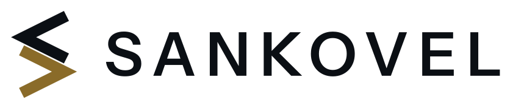
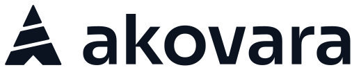

  <picture>
    <source media="(prefers-color-scheme: dark)" srcset="https://raw.githubusercontent.com/sankovel/.github/main/profile/assets/sankovel-logo-on-dark.svg">
    
  </picture>

**Security and compliance software for Africa's financial sector.** Built in Accra, Ghana.

*Look back. Build forward.* Our name comes from **Sankofa**: learn from what came before, then move ahead.

### Products

<picture>
  <source media="(prefers-color-scheme: dark)" srcset="https://raw.githubusercontent.com/sankovel/.github/main/profile/assets/akovara-logo-on-dark.svg">
  
</picture>

**Akovara** gives banks, savings and loans companies, microfinance institutions, fintechs and insurers in Ghana external threat monitoring. It finds the lookalike domains, fake apps, impersonation, leaked credentials and dark-web chatter that use their name, then helps take them down.

### Security

To report a vulnerability, email **security@sankovel.com**. Please don't open a public issue.
